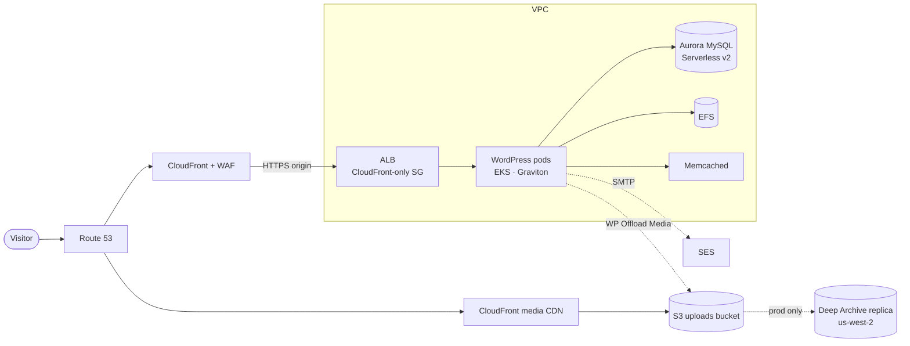

# wp.lodge104.net

Infrastructure as code for the **Lodge 104 WordPress multisite**
([lodge104.net](https://lodge104.net)) on AWS, managed with
[Terragrunt](https://terragrunt.gruntwork.io/) and Terraform.

Each environment is a full, isolated stack: WordPress (Bitnami Helm chart) on
EKS, Aurora MySQL Serverless v2, EFS, an S3 + CloudFront media CDN and a
WAF-protected CloudFront distribution in front of everything.

## Architecture



- **Edge:** CloudFront terminates TLS (ACM), applies the WAF and tuned
  WordPress/WooCommerce cache behaviours, and serves branded 502/503/403
  pages. The ALB only accepts traffic from CloudFront's origin-facing IP
  ranges.
- **Compute:** EKS managed node groups on Graviton (arm64). Add-ons: AWS Load
  Balancer Controller, metrics-server, Secrets Store CSI driver, EFS CSI
  driver and CloudWatch Observability. WordPress scales with an HPA.
- **Data:** Aurora MySQL Serverless v2 with credentials in Secrets Manager,
  mounted into pods through the CSI driver. `wp-content` lives on EFS; media
  is offloaded to S3 and served from the CDN.
- **Observability:** Amazon Managed Prometheus (managed scraper), CloudWatch
  Container Insights, WAF logs and CloudFront access logs (prod).
- **Access:** an SSM-only bastion (no SSH) plus an `env-promotion` Lambda
  that copies data down the env chain (`prod → test → dev`).

## Environments

| Env | Hostname | Notes |
|---|---|---|
| `prod` | `lodge104.net` (+ `www`, `store`, `cdn`) and `prod.wp.lodge104.net` | On-demand + spot nodes, HPA up to 10, deletion protection, 30-day backups, CDN archive replication |
| `test` | `test.wp.lodge104.net` | Production-like, smaller |
| `dev` | `dev.wp.lodge104.net` | Spot nodes, no HPA/PDB, cheapest settings |

All envs run in `us-east-1`. DNS is delegated as
`lodge104.net → wp.lodge104.net → <env>.wp.lodge104.net`. Account-wide pieces
(DNS zones, the bastion, env promotion, the apex-domain cutover) live in
`global/`.

## Repository layout

```text
root.hcl              Remote state (S3, one key per stack) + generated AWS provider
project.hcl           Project constants (name, domain, parent zone)
_common/              ALL stack logic: one <stack>.hcl fragment per stack
  _env.hcl            Resolves env/region/project context for any stack
  shared/             Values other stacks need (k8s version, DB name, chart)
  wordpress/          Helm values (base.yaml + per-env templates)
  README.md           Detailed guide: "to change X, edit Y", env knobs, gotchas
_modules/             Local Terraform modules (bastion, cloudfront, efs, helm-release, ...)
dev/ test/ prod/
  env.hcl             Env-level knobs (sizing, flags) – only what differs
  us-east-1/
    region.hcl
    <stack>/terragrunt.hcl   10-line shim: include root + include _common/<stack>.hcl
global/<stack>/terragrunt.hcl  Account-wide stacks, same shim pattern
scripts/              Scaffolding, linting and no-op verification helpers
```

Every `terragrunt.hcl` under `dev/`, `test/`, `prod/` and `global/` is a
**thin shim**:

```hcl
include "root" {
  path = find_in_parent_folders("root.hcl")
}

include "common" {
  path = "${get_repo_root()}/_common/vpc.hcl"
}

inputs = {}
```

So a routine change is one edit in `_common/` (applies to every env) or in an
env's `env.hcl` (one env only). See **[`_common/README.md`](_common/README.md)**
for where each setting lives and the full list of env knobs.

## Getting started

### Prerequisites

The [dev container](.devcontainer/devcontainer.json) (GitHub Codespaces or VS
Code) has everything installed. To work locally you need:

- Terragrunt **v1.1.x** (CI pins 1.1.6) and Terraform **≥ 1.9**
- AWS CLI v2, with credentials for the project account (AWS IAM Identity
  Center / SSO)
- `kubectl` and `helm` for working with the clusters
- Optional: [`pre-commit`](https://pre-commit.com/) and `jq`

### Plan and apply a stack

```bash
aws sso login                              # or export credentials
cd test/us-east-1/wordpress
terragrunt plan
terragrunt apply
```

Run every stack in an environment, in dependency order:

```bash
cd test
terragrunt run --all plan
```

State lives in `s3://net-lodge104-wp-terraform-state/<stack path>/terraform.tfstate`
with S3-native locking. For read-only checks use `terragrunt plan -lock=false`.

> **Promote changes `dev → test → prod`.** A change in `_common/` affects
> every environment at once; plan it in each env before applying to prod.

### Connect to a cluster

```bash
aws eks update-kubeconfig --name net-lodge104-wp-<env> --region us-east-1 --alias <env>
kubectl --context <env> -n wordpress get pods
```

## Common tasks

| Task | How |
|---|---|
| Resize an environment (nodes, DB ACUs, WordPress replicas) | Edit `<env>/env.hcl` |
| Change a setting for all environments | Edit `_common/<stack>.hcl` |
| Bump a module or chart version | `terraform { source }` in `_common/<stack>.hcl`, or `_common/shared/*.hcl` |
| Add a new stack | `scripts/new-stack.sh <stack> <module-source> [dev test prod \| global]` |
| Prove a refactor is a no-op | `scripts/render-snapshot.sh /tmp/before` → change → `scripts/render-snapshot.sh /tmp/after` → `diff -r` |
| Copy prod data into test | Invoke the `env-promotion` Lambda – see [`_modules/env-promotion`](_modules/env-promotion/README.md) |

## Quality checks

| Check | Command | Runs in |
|---|---|---|
| HCL formatting | `terragrunt hcl fmt --check` | CI, pre-commit |
| Thin-shim lint | `scripts/lint-shims.sh` | CI, pre-commit |
| Offline render of all stacks | `scripts/render-snapshot.sh <dir>` | CI |
| `_env.hcl` resolution | `scripts/verify-env-helper.sh` | manual |
| Terraform fmt / module docs | `terraform fmt`, `terraform-docs` | pre-commit |
| Security scan | tfsec | CI (`prod`) |
| Lint (MegaLinter) | – | CI (PRs to `prod`) |

```bash
pre-commit install          # run the checks on every commit
pre-commit run --all-files
```

## Further reading

- [`_common/README.md`](_common/README.md) – configuration guide, env knobs,
  Terragrunt gotchas
- [`_modules/`](_modules) – module READMEs (env-promotion, helm-release, efs,
  s3-replication, ses-smtp-user)

## License

Released into the public domain under [The Unlicense](LICENSE).
